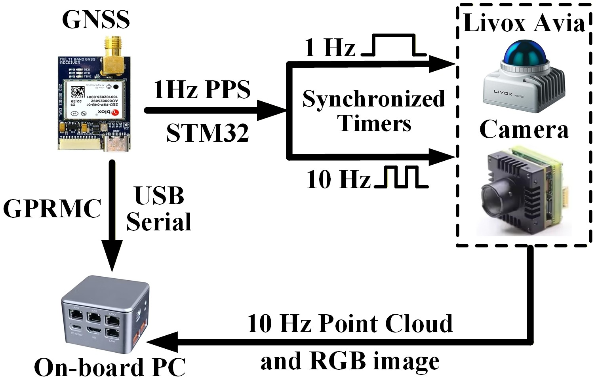

# FAST-LIVGO based on FAST-LIVO2-RTK

This branch ports the RTK/GNSS extensions from the official ROS 1
[FAST-LIVO2-RTK](https://github.com/xuankuzcr/FAST-LIVO2-RTK) repository onto
the ROS 2 version of FAST-LIVO2. The workspace currently builds against ROS 2
Jazzy. It provides online RTK-constrained LIO updates and an offline GTSAM
optimization backend while keeping the GNSS
message package independent from the mapping package.

This package is vendored in the Coolfly ROS 2 workspace. See the [workspace
README](../../../README.md) for the active build entry point and the
[upstream record](UPSTREAM.md) for the imported revision.


## Platform and dependencies

The current build environment is Ubuntu 24.04 with ROS 2 Jazzy. See the
[workspace dependency guide](../../../docs/ROS2_JAZZY_DEPENDENCIES.md) for the
complete list of binary packages and install commands. The core RTK packages
are:

```bash
sudo apt update
sudo apt install libgeographiclib-dev ros-jazzy-gtsam
```

`gnss_comm` is a separate source-built ROS 2 package. Its install workspace
must be sourced before building this package. Sophus and the ROS 2-compatible
Vikit revision are vendored under `third_party/`; no system-wide Sophus/Vikit
installation is required.

Do not install a second GTSAM build under `/usr/local` unless it uses the same
system Eigen version as ROS 2. Use the GTSAM package provided for the selected
ROS 2 distribution.

## Repository layout

`gnss_comm` remains a separate ROS 2 package. It defines
`gnss_comm/msg/GnssPVTSolnMsg`, which FAST-LIVO2-RTK consumes. Keep that message
package independently maintained and source its install space before building:

```text
coolfly_project/
|-- src/fast_livgo/
`-- <separate gnss_comm workspace>/install/
```

## Build

Build the package from the Coolfly repository root. If `gnss_comm` is in a
separate workspace, pass its generated setup script through `GNSS_COMM_SETUP`:

```bash
source /opt/ros/jazzy/setup.bash
GNSS_COMM_SETUP=/path/to/gnss_comm_ws/install/setup.bash \
  ./scripts/setup_ws.sh
source install/setup.bash
```

## Run the provided datasets

Source ROS 2, the `gnss_comm` workspace, and the Coolfly workspace in each new
terminal. Use the HH launch file for the
handheld `HH-LVGO` dataset and the AGV launch file for the vehicle-mounted
`AGV-LVGO` dataset:

```bash
source /opt/ros/jazzy/setup.bash
source /path/to/gnss_comm_ws/install/setup.bash
source /path/to/coolfly_project/install/setup.bash

ros2 launch fast_livgo mapping_hh.launch.py \
  rviz:=true output_dir:=~/.ros/fast_livgo_rtk/hh

# Or, for the AGV dataset:
ros2 launch fast_livgo mapping_agv.launch.py \
  rviz:=true output_dir:=~/.ros/fast_livgo_rtk/agv
```

Play the corresponding converted ROS 2 bag in another sourced terminal:

```bash
source /opt/ros/jazzy/setup.bash
source /path/to/gnss_comm_ws/install/setup.bash
source /path/to/coolfly_project/install/setup.bash
ros2 bag play /path/to/HH-LVGO-01_ros2
```

The workspace overlay is required in the playback terminal because the bag
contains `fast_livgo/msg/CustomMsg`. Without it, rosbag2 can publish standard
IMU and image messages but cannot create the custom LiDAR publisher, leaving
the mapper and RViz without odometry or point-cloud output.

After playback has finished, trigger the batch RTK optimization through the
ROS 2 service:

```bash
ros2 service call /fast_livgo/trigger_optimization \
  std_srvs/srv/Trigger '{}'
```

The ROS 1 implementation's terminal `Enter` trigger is not used on this
branch.

RViz displays `/cloud_registered` as a three-second RGB trail. The history is
bounded inside RViz; the mapper does not maintain or repeatedly serialize a
second visualization map. This keeps visualization work from reducing the
real-time performance of the estimator.

The comparison image at the top of this README is not a live RViz capture. It
shows the offline RTK-optimized result. For a comparable final map, let the bag
finish, call the optimization service, and inspect
`<output_dir>/global_pcd/after_optimization.pcd` in a point-cloud viewer. The
bounded live trail is intended for progress monitoring rather than final map
quality evaluation.

Useful runtime outputs include:

```text
/gps/odometry
/odometry/fast_livgo2
/synced_cloud
/fast_livgo/trigger_optimization
```

All trajectories, maps, debug files, images and Colmap exports are written
under `output_dir`. No runtime output is written into the source repository.

## Configuring another platform

Start from `config/HH-LVGO.yaml` or `config/AGV-LVGO.yaml` and provide a
matching camera YAML. At minimum, verify the LiDAR, IMU, image and GNSS topic
names, sensor types, time offsets, camera intrinsics, LiDAR-to-IMU,
LiDAR-to-camera and IMU-to-GNSS extrinsics, and covariance parameters. Copy
one of the corresponding Python launch files and replace its two YAML paths;
keep the `output.directory` launch override so runtime files remain external.

The original platform synchronizes GNSS, LiDAR and camera measurements as
shown below:



## Credits and license

This repository extends
[FAST-LIVO2](https://github.com/hku-mars/FAST-LIVO2) and uses
[GTSAM](https://github.com/borglab/gtsam),
[GeographicLib](https://geographiclib.sourceforge.io/) and
[gnss_comm](https://github.com/HKUST-Aerial-Robotics/gnss_comm).

The source code is released under the [GPLv2](LICENSE). For commercial use,
contact Chunran Zheng and Prof. Fu Zhang as described by the upstream project.
